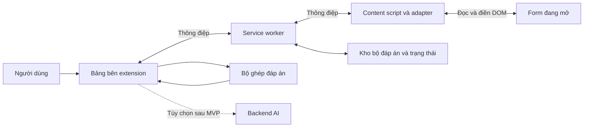

# Báo cáo ý tưởng: Auto Fill Form

**Cập nhật 26/10/2026:** bản JSON v0.3.0 đã được triển khai trên nhánh `feat/json-answer-workflow`. Xem [báo cáo triển khai và giới hạn kiểm thử](./IMPLEMENTATION_REPORT.md). Các mốc 0.2.x bên dưới mô tả thiết kế và kết quả trước đợt này; [README](./README.md) phản ánh cách dùng hiện tại.

**Ngày lập:** 25/10/2026  
**Loại tài liệu:** Đề xuất sản phẩm và thiết kế kỹ thuật  
**Trạng thái:** Đã triển khai bản thử nghiệm v0.2.2, cập nhật 200 đáp án từ PDF mới 89 trang ngày 26/10/2026. Đã đối chiếu theo nội dung và cập nhật một lựa chọn khác bộ trước; chữ và trạng thái chọn được trích xuất trực tiếp từ PDF. ZIP giữ manifest tại gốc để nạp được ngay. Đây là báo cáo thiết kế và định hướng mở rộng; hướng dẫn cài, phạm vi thực tế và kết quả kiểm thử xem [README](./README.md).

**Hướng tương lai theo yêu cầu mới:** nhập PDF đáp án của form khác, trích xuất/OCR, duyệt kết quả và lưu thành bộ đáp án. Tính năng chưa có trong extension và được giữ mở tại [ROADMAP](./ROADMAP.md), chưa triển khai trong đợt này.

**Bổ sung v0.2.0:** xử lý PDF ảnh 52 trang bằng OCR tại máy và nhận diện radio được chọn; rà soát trực quan 200 đáp án, sửa lỗi nhận dạng dấu ≥ và số thập phân, đóng gói JSON với ID form. Bảng bên tự quét và tự nạp bộ đáp án phù hợp; người dùng bấm Điền và tự nộp bài. Không tự đoán họ tên/mã sinh viên. Xem [danh sách đáp án](./data/ANSWERS.md) và [thông tin nguồn](./data/answer-source-audit.json).

**Cập nhật triển khai:** bản đầu dùng JavaScript thuần thay cho TypeScript/Vite để nạp trực tiếp, không cần build. Đã có Manifest V3, bảng bên, nhập/xuất JSON, nhập đáp án trực tiếp, adapter Choice/Text, điền–xác minh–hoàn tác và form demo. Đã đạt 10 unit test và 12 bước kiểm tra trình duyệt với fixture cục bộ trên Chrome 155. Link form thật được cung cấp yêu cầu đăng nhập trong trình duyệt kiểm thử, nên chưa xác nhận tương thích trên form đó. AI, CSV và các loại câu mở rộng vẫn thuộc lộ trình.

## 1. Đề xuất chính

Xây dựng extension Chrome giúp đọc câu hỏi trên form kiểm tra, tìm đáp án từ nguồn người dùng cung cấp và điền vào các trường tương ứng. Người dùng xem trước kết quả, chọn câu cần điền và kiểm tra lại ngay trên form.

Tên làm việc: **Auto Fill Form**. Thông điệp sản phẩm: **“Đọc câu hỏi, ghép đáp án, điền có kiểm soát.”**

Nền tảng mục tiêu là **Microsoft Forms tại `https://forms.cloud.microsoft/`, form một trang, câu hỏi dạng văn bản**, dùng bộ đáp án JSON hoặc nhập trực tiếp trong bảng bên. Bản đầu cũng cho phép trang trả lời trên `forms.office.com`. Sau khi kiểm chứng trên các form thật, bổ sung chế độ AI đề xuất đáp án.

Tên miền người dùng đề cập là `form.cloud.microsoft`. Tài liệu Microsoft xác nhận tên miền Microsoft Forms là **`forms.cloud.microsoft`**, có chữ **s**; báo cáo dùng tên miền đã được xác nhận này. Chưa xác nhận địa chỉ số ít có chuyển hướng hay không. [Microsoft Learn — Cookies used in Microsoft 365 web apps and services, mục Forms](https://learn.microsoft.com/en-us/microsoft-365-apps/privacy/web-cookies#forms).

Phạm vi sử dụng dự kiến gồm form luyện tập, kiểm thử form và bài kiểm tra được phép dùng công cụ hỗ trợ. Người dùng thực hiện thao tác nộp bài trên giao diện form.

## 2. Bài toán và người dùng

| Nhóm người dùng | Nhu cầu | Giá trị nhận được |
| --- | --- | --- |
| Người học luyện tập | Điền đáp án đã chuẩn bị, đối chiếu và đọc giải thích | Giảm thao tác lặp lại, thuận tiện ôn tập |
| Giáo viên, người tạo form | Thử nhiều bộ đáp án trên form của mình | Kiểm tra cấu hình và trải nghiệm làm bài |
| Nhóm QA, đào tạo nội bộ | Điền dữ liệu mẫu cho các biểu mẫu lặp lại | Giảm thời gian nhập liệu và dễ tái hiện lỗi |

Ví dụ: một form có 30 câu hỏi và một bộ đáp án tương ứng. Extension quét câu hỏi, trình bày các cặp câu hỏi–đáp án, chỉ ra câu chưa khớp và điền các câu người dùng chọn. Con số 30 chỉ minh họa luồng sử dụng.

## 3. Ba hướng sản phẩm

| Hướng | Cách hoạt động | Điểm mạnh | Hạn chế | Đề xuất |
| --- | --- | --- | --- | --- |
| A. Điền theo bộ đáp án | Nhập JSON, ghép nội dung câu hỏi và lựa chọn | Có nguồn rõ ràng, không cần API AI | Cần chuẩn bị đáp án; phải xử lý câu trùng | Làm trước |
| B. AI đề xuất đáp án | Gửi câu hỏi đã chọn tới dịch vụ AI, nhận đáp án và giải thích | Hữu ích khi chưa có bộ đáp án | Có thể trả lời sai; phát sinh chi phí và truyền dữ liệu | Giai đoạn sau |
| C. Kết hợp | Ưu tiên bộ đáp án; AI xử lý câu chưa tìm được | Bao phủ nhiều tình huống hơn | Khó quản lý nguồn và trạng thái hơn | Mục tiêu dài hạn |

**Khuyến nghị:** chọn A cho MVP, tiến tới C. Khả năng điền đúng trường và phát hiện câu mơ hồ phải được kiểm chứng trước khi mở rộng nguồn đáp án.

## 4. Phạm vi tính năng

### MVP: bản tối thiểu có thể dùng thử

| Tính năng | Hành vi mong muốn | Ưu tiên |
| --- | --- | --- |
| Quét form | Đọc câu hỏi, loại trường, lựa chọn và trạng thái hiện tại | P0 |
| Nhập bộ đáp án JSON | Kiểm tra phiên bản dữ liệu, kiểu câu hỏi, ID và giá trị đáp án | P0 |
| Ghép đáp án | Ưu tiên ID ổn định nếu có; tiếp theo là nội dung và tập lựa chọn | P0 |
| Xem trước | Hiển thị đáp án, nguồn, trạng thái khớp và lỗi theo từng câu | P0 |
| Điền câu được chọn | Mặc định chỉ điền câu trống, không âm thầm ghi đè câu đã trả lời | P0 |
| Xác minh sau khi điền | Đọc lại giá trị thực trên form; đánh dấu thành công hoặc thất bại | P0 |
| Hoàn tác | Khôi phục giá trị trước lần điền nếu trang và trường vẫn tương ứng | P0 |
| Quản lý bộ đáp án | Đổi tên, xuất, xóa bộ đáp án lưu trên máy | P1 |
| Tìm kiếm trong danh sách | Lọc câu chưa khớp, đã điền, lỗi hoặc cần duyệt | P1 |

P0 là điều kiện cho lần phát hành thử; P1 triển khai nếu còn thời gian sau khi P0 ổn định. MVP hỗ trợ một lựa chọn, nhiều lựa chọn và văn bản ngắn. Một lựa chọn và nhiều lựa chọn dùng nội dung đáp án, không phụ thuộc nhãn A/B/C/D.

### Các giai đoạn tiếp theo

- Nhập CSV theo mẫu công bố rõ ràng; hỗ trợ xem trước trước khi nhập.
- AI đề xuất đáp án và giải thích cho câu người dùng chọn.
- Thêm bộ đáp án theo môn học, chủ đề và phiên bản form.
- Form nhiều trang: quét lại từng trang sau khi người dùng chuyển trang.
- Adapter cho Google Forms hoặc website nội bộ sau khi có form mẫu.
- OCR, câu hỏi hình ảnh, công thức và bảng lựa chọn sau khi đánh giá riêng.

**Ngoài MVP:** tự nộp bài, tự chuyển trang, tải tệp, câu hỏi lưới, canvas, iframe khác nguồn và các nền tảng yêu cầu cơ chế truy cập đặc biệt. Mục tiêu không bao gồm lấy đáp án ẩn từ hệ thống hoặc vượt giới hạn truy cập.

### Phạm vi riêng cho Microsoft Forms

| Hạng mục | Thiết kế áp dụng |
| --- | --- |
| Trang mục tiêu | Trang trả lời form/quiz tại `forms.cloud.microsoft`, mở trực tiếp trong tab |
| Nhận diện nền tảng | Kiểm tra HTTPS và hostname chính xác, sau đó xác nhận cấu trúc trang trả lời; tên miền đúng chưa đủ để cho phép điền |
| Đường dẫn tương thích khác | `forms.office.com` là địa chỉ được tài liệu Microsoft sử dụng; đưa vào khảo sát riêng, chỉ công bố hỗ trợ sau khi kiểm thử |
| Choice một đáp án | Ánh xạ sang `single_choice`; đọc lựa chọn và trạng thái đang chọn |
| Choice nhiều đáp án | Ánh xạ sang `multiple_choice`; xác minh đầy đủ tập lựa chọn sau khi điền |
| Text ngắn | Ánh xạ sang `short_text`; đọc lại nội dung và kiểm tra thông báo lỗi của trường |
| Loại khác | Dropdown, Other có ô nhập, Text dài, Rating, Date, Ranking, Likert, File upload và Net Promoter Score cần khảo sát riêng; chưa thuộc MVP |
| Phiên truy cập | Người dùng tự đăng nhập nếu form yêu cầu; chỉ thao tác với form đã mở được trong phiên hiện tại |
| Trang không xử lý | Trang tạo/sửa form, quản lý kết quả, màn hình đăng nhập, form đã đóng hoặc trang báo không có quyền |

Microsoft Forms có Choice, Text và nhiều loại câu hỏi khác; Choice có tùy chọn nhiều đáp án, xáo trộn lựa chọn và dropdown. Vì vậy adapter cần phân biệt từng biến thể trước khi điền, thay vì giả định mọi Choice đều là radio. [Microsoft Support — Create a quiz](https://support.microsoft.com/en-us/forms/create-a-quiz-with-microsoft-forms).

Microsoft Forms cũng hỗ trợ phân nhánh theo câu trả lời. MVP chỉ nhận form một trang không phân nhánh; nếu câu trả lời làm xuất hiện, ẩn hoặc thay đổi câu hỏi, extension phải hủy phần kế hoạch bị ảnh hưởng và yêu cầu quét lại. Các câu ẩn không được tính là câu thiếu đáp án. Hỗ trợ hoàn chỉnh phân nhánh và nhiều phần thuộc giai đoạn sau. [Microsoft Support — Use branching logic](https://support.microsoft.com/en-us/forms/use-branching-logic-in-your-form).

Adapter bản đầu dùng nhóm `questionItem`, nhãn `questionTitle`, quan hệ nhãn–control và role; hạn chế phụ thuộc class CSS hoặc chữ “Next/Gửi” theo ngôn ngữ. Cần khảo sát thêm DOM form thật sau đăng nhập. Hiện hệ thống kiểm tra lại cấu trúc trước lần điền và trước từng câu; chưa theo dõi thay đổi trực tiếp khi người dùng đang xem trước. Có thể bổ sung `MutationObserver` có debounce ở giai đoạn sau.

## 5. Luồng trải nghiệm

1. Người dùng mở form và bấm biểu tượng extension trên thanh công cụ.
2. Bảng bên mở ra; người dùng chọn **Quét form**.
3. Extension hiển thị số câu đọc được và những loại trường chưa hỗ trợ.
4. Người dùng nhập hoặc chọn bộ đáp án; hệ thống hiển thị lỗi dữ liệu nếu có.
5. Bảng xem trước phân loại từng câu: khớp rõ ràng, cần duyệt, thiếu đáp án hoặc không hỗ trợ.
6. Người dùng sửa ánh xạ nếu cần và bấm **Điền các câu đã chọn**.
7. Extension kiểm tra form chưa thay đổi, lưu trạng thái trước khi điền, thực hiện và đọc lại kết quả.
8. Bảng bên báo số câu thành công, thất bại và nguyên nhân; có nút **Hoàn tác lần điền**.

Giao diện đề xuất có ba phần: **Nguồn đáp án**, **Danh sách câu hỏi**, **Kết quả điền**. Mỗi dòng câu hỏi có ô chọn, nội dung rút gọn, đáp án, nguồn và trạng thái. Các câu cần duyệt không được tự chọn sẵn.

Ví dụ bảng xem trước, dữ liệu minh họa:

| Câu | Đáp án đề xuất | Nguồn | Trạng thái |
| --- | --- | --- | --- |
| Thủ đô Việt Nam là gì? | Hà Nội | Bộ đáp án “Địa lý cơ bản” | Khớp rõ ràng |
| Chọn các số nguyên tố | 2; 3 | Bộ đáp án “Toán cơ bản” | Khớp rõ ràng |
| Câu hỏi trùng nội dung ở hai phần | Chưa chọn | Hai bản ghi khác nhau | Cần duyệt |

## 6. Kiến trúc đề xuất



| Thành phần | Trách nhiệm |
| --- | --- |
| Bảng bên | Nhập đáp án, xem trước, duyệt và điều khiển điền |
| Service worker | Điều phối thông điệp, cấp tác vụ theo tab, xử lý sự kiện |
| Content script | Truy cập DOM, đọc câu hỏi, điền và xác minh giá trị |
| Adapter nền tảng | Ưu tiên Microsoft Forms: nhận diện trang trả lời, đọc Choice/Text, điền và xác minh; tách adapter cho nền tảng khác |
| Bộ ghép đáp án | Chuẩn hóa dữ liệu, tìm bản ghi, phát hiện xung đột |
| Storage | Lưu bộ đáp án, cấu hình và phiên làm việc theo phạm vi |
| Backend AI tùy chọn | Giữ khóa dịch vụ, giới hạn chi phí, xác thực và kiểm tra kết quả |

Content script có thể đọc và thay đổi DOM, đồng thời trao đổi thông điệp với các thành phần extension. Đây là cơ sở kỹ thuật cho lớp adapter; không đồng nghĩa mọi loại form đều tương thích. [Tài liệu Content scripts](https://developer.chrome.com/docs/extensions/develop/concepts/content-scripts).

Bản v0.1.0 dùng JavaScript thuần, HTML/CSS và Manifest V3, không cần công cụ build. Có thể chuyển sang TypeScript và Vite khi dự án lớn hơn. Side Panel API cung cấp giao diện cạnh trang web và cần quyền `sidePanel`. [Tài liệu Side Panel](https://developer.chrome.com/docs/extensions/reference/api/sidePanel).

### Quyền extension

| Quyền dự kiến | Mục đích |
| --- | --- |
| `activeTab` | Quyền tạm thời với tab khi người dùng kích hoạt extension |
| `scripting` | Chèn content script vào tab được cấp quyền |
| `storage` | Lưu bộ đáp án và cấu hình |
| `sidePanel` | Hiển thị bảng điều khiển bên cạnh form |

Thiết kế MVP dùng thao tác bấm biểu tượng extension để bắt đầu phiên. `activeTab` cấp quyền tạm thời sau thao tác người dùng; khi chuyển sang nguồn khác, có thể phải kích hoạt lại. Chỉ mở bảng bên từ menu trình duyệt không nên được coi là đã cấp quyền tab. [Tài liệu activeTab](https://developer.chrome.com/docs/extensions/develop/concepts/activeTab).

Với Microsoft Forms, MVP chèn script theo thao tác người dùng bằng `activeTab` + `scripting`, rồi kiểm tra hostname `forms.cloud.microsoft` và trang trả lời. Không cần khai báo quyền host thường trực chỉ để xử lý tab này theo luồng MVP. Nếu điều hướng qua trang đăng nhập hoặc sang hostname khác, phải đánh giá lại quyền, xác nhận đã trở về trang trả lời và quét mới trước khi điền. Form nhúng trong Teams/SharePoint chưa thuộc MVP; người dùng mở trực tiếp đường dẫn trả lời trong tab trình duyệt.

Nếu bổ sung AI, chỉ xin quyền host cho backend cụ thể khi người dùng bật tính năng. Cấu hình phát hành cần kiểm tra quyền thực tế của từng API được dùng.

### Trạng thái và vòng đời

- `storage.local`: bộ đáp án, phiên bản dữ liệu và cấu hình lâu dài.
- Bản v0.1.0 giữ kế hoạch điền và dữ liệu hoàn tác trong content script theo tài liệu; worker dừng không làm mất bản này, nhưng reload/đóng tab sẽ mất. `storage.session` hiện chỉ giữ định danh tab được mở từ biểu tượng extension; có thể mở rộng quản lý phiên sau này.
- Khi triển khai, giới hạn quyền truy cập storage cho các ngữ cảnh cần thiết; content script chỉ nhận phần dữ liệu cần điền.
- Khóa tác vụ theo `tabId`, `documentId` hoặc mã nhận diện tài liệu tương đương, fingerprint form và `runId` để tránh điền trùng hoặc dùng kế hoạch của trang cũ.

Chrome có thể dừng service worker khi không hoạt động và biến toàn cục sẽ mất. Vì vậy không giữ phiên duy nhất trong bộ nhớ worker; cần khôi phục trạng thái và kiểm tra lại DOM trước khi tiếp tục. [Vòng đời service worker](https://developer.chrome.com/docs/extensions/develop/concepts/service-workers/lifecycle), [Storage API](https://developer.chrome.com/docs/extensions/reference/api/storage).

## 7. Cách ghép câu hỏi với đáp án

### Dữ liệu đầu vào minh họa

`formKey` dưới đây là định danh do dự án quản lý. `questionId` là ID trong bộ đáp án, không mặc nhiên là ID của nền tảng.

```json
{
  "schemaVersion": 1,
  "name": "Bộ đáp án mẫu",
  "formKey": "demo-basic-v1",
  "answers": [
    {
      "questionId": "q1",
      "question": "Thủ đô Việt Nam là gì?",
      "type": "single_choice",
      "options": ["Hà Nội", "Đà Nẵng", "TP. Hồ Chí Minh"],
      "answer": ["Hà Nội"]
    },
    {
      "questionId": "q2",
      "question": "Chọn các số nguyên tố",
      "type": "multiple_choice",
      "options": ["2", "3", "4"],
      "answer": ["2", "3"]
    },
    {
      "questionId": "q3",
      "question": "Điền kết quả: 2 + 2 = ?",
      "type": "short_text",
      "answer": "4"
    }
  ]
}
```

Quy tắc kiểm tra: `schemaVersion` phải được hỗ trợ; `questionId` không trùng trong một bộ; `single_choice` có đúng một đáp án; `multiple_choice` có ít nhất một đáp án; mọi đáp án lựa chọn phải tồn tại duy nhất trong `options`; `short_text` dùng chuỗi. Dữ liệu sai được chỉ rõ bản ghi và nguyên nhân trước khi nhập.

### Thứ tự ghép

1. Chuẩn hóa Unicode NFC, khoảng trắng và chữ hoa/thường cho khóa so sánh; giữ nguyên dấu tiếng Việt, số, toán tử và nội dung gốc.
2. Nếu adapter có ID ổn định đã liên kết với bộ đáp án, thử ghép ID và kiểm tra lại loại trường, nội dung, lựa chọn.
3. Nếu không có ID, ghép chính xác câu hỏi đã chuẩn hóa, loại trường và tập lựa chọn. Thứ tự lựa chọn không tham gia định danh.
4. Nếu có nhiều bản ghi hoặc nhiều trường cùng khớp, yêu cầu người dùng chọn; có thể dùng ngữ cảnh phần để hỗ trợ phân biệt.
5. Nếu chỉ gần giống về nội dung, hiển thị ứng viên để duyệt. MVP có thể bỏ hẳn so khớp gần đúng để giảm điền nhầm.
6. Không có ứng viên hợp lệ thì đánh dấu thiếu đáp án và bỏ qua.

Không dùng số thứ tự câu hoặc chữ A/B/C/D làm khóa duy nhất. Không loại bỏ dấu tiếng Việt hoặc dấu toán học vì có thể làm hai câu khác nghĩa trở thành giống nhau. Nếu lựa chọn chứa nội dung trùng, phải đánh dấu mơ hồ thay vì lấy phần tử đầu tiên.

### Điền, xác minh và hoàn tác

- Quét DOM ngay trước khi điền; nếu câu hỏi hay tập lựa chọn đã thay đổi, hủy ánh xạ liên quan và yêu cầu quét lại.
- Adapter dùng tương tác phù hợp từng loại control, phát sự kiện cần thiết và đọc lại trạng thái sau khi giao diện ổn định. Chỉ gán thuộc tính `value` có thể chưa đủ với control do framework quản lý.
- Không ghi đè câu đã có đáp án trừ khi người dùng chủ động chọn ghi đè trong bảng xem trước.
- Lưu trạng thái trước từng câu, ghi kết quả theo câu và cho phép thử lại riêng câu lỗi.
- Hoàn tác chỉ áp dụng khi còn đúng tài liệu và trường; nếu người dùng đã sửa tiếp sau lần điền, bỏ qua trường đó và báo xung đột.
- Form có thể lưu bản nháp lên máy chủ khi giá trị thay đổi. Hoàn tác là nỗ lực khôi phục giá trị giao diện, không bảo đảm thu hồi dữ liệu đã được nền tảng lưu.

## 8. Thiết kế chế độ AI

AI là một nguồn đề xuất đáp án bổ sung. Luồng dự kiến:

1. Người dùng chọn câu hỏi và xem phần dữ liệu sẽ gửi.
2. Chỉ gửi nội dung câu hỏi, lựa chọn và tài liệu tham chiếu được chọn; loại trường họ tên, email hoặc mã học viên nếu không cần thiết.
3. Backend trả JSON có `questionId`, đáp án, giải thích và tài liệu tham chiếu nếu có.
4. Kiểm tra schema, ID câu hỏi và sự tồn tại của đáp án trong các lựa chọn; nội dung trả về chỉ được xử lý như dữ liệu.
5. Hiển thị nhãn **“AI đề xuất — chưa xác minh”**. Người dùng duyệt trước khi đưa vào kế hoạch điền.

Không diễn giải điểm tự tin của mô hình thành xác suất trả lời đúng. Chất lượng cần được đo trên bộ câu có đáp án kiểm chứng. Nội dung câu hỏi được xem là dữ liệu không tin cậy, tránh để chỉ dẫn nằm trong câu hỏi làm thay đổi quy tắc hệ thống hoặc kích hoạt công cụ ngoài phạm vi.

Đề xuất lưu khóa nhà cung cấp AI ở backend, dùng phiên xác thực và hạn mức cho client. Không nhúng khóa vào gói extension hoặc ghi khóa vào log. Lỗi mạng, hết hạn mức hay JSON không hợp lệ phải trả trạng thái theo câu, không tự tạo đáp án thay thế.

## 9. Rủi ro và phương án xử lý

| Rủi ro | Tác động | Phương án |
| --- | --- | --- |
| Cấu trúc Microsoft Forms thay đổi | Đọc sai hoặc không điền được | Adapter riêng, bộ form mẫu, dừng với loại control chưa nhận diện |
| Phân nhánh hoặc đổi phần | Câu hỏi cũ bị ẩn, câu mới xuất hiện | MVP giới hạn một trang không phân nhánh; phát hiện thay đổi và yêu cầu quét lại |
| Điều hướng đăng nhập hoặc thiếu quyền | Mất quyền tab hoặc không có form để đọc | Dừng tác vụ, để người dùng hoàn tất truy cập và kích hoạt lại extension |
| Câu hoặc lựa chọn bị xáo trộn | Ghép sai nếu phụ thuộc vị trí | Ghép bằng nội dung và tập lựa chọn |
| Câu trùng, phủ định, khác dấu toán học | Đáp án có thể bị gán nhầm | Chuẩn hóa bảo thủ, phát hiện mơ hồ, duyệt thủ công |
| DOM đổi trong lúc xem trước | Kế hoạch điền mất hiệu lực | Kiểm tra fingerprint và ánh xạ lại trước khi điền |
| Worker dừng, tác vụ lặp | Mất tiến độ hoặc điền hai lần | Lưu phiên, mã tác vụ duy nhất, kiểm tra trạng thái khi khôi phục |
| AI trả lời sai | Nội dung điền sai dù thao tác thành công | Phân biệt nguồn, duyệt trước, đánh giá bằng đáp án chuẩn |
| Dữ liệu form bị gửi quá mức | Lộ nội dung không cần thiết | Xử lý local trong MVP; xem trước dữ liệu khi bật AI |
| Control hoặc iframe chưa hỗ trợ | Bỏ sót trường | Báo rõ trường bị bỏ qua; mở rộng adapter sau thử nghiệm |

## 10. Kế hoạch triển khai

Ước lượng dưới đây dành cho một lập trình viên quen TypeScript và extension, làm MVP theo phạm vi đã nêu. Đây là ước lượng lập kế hoạch, chưa phải cam kết; cần điều chỉnh sau khảo sát form mẫu.

| Chặng | Nội dung | Ước lượng |
| --- | --- | --- |
| 1. Khảo sát | Chọn 3–5 Microsoft Forms mẫu, xác nhận hostname, trang trả lời, Choice/Text và khả năng điền | 1–2 ngày công |
| 2. Nền tảng | Manifest, bảng bên, messaging và quản lý phiên theo tab | 2 ngày công |
| 3. Đáp án | Schema JSON, nhập file, lưu trữ và bộ ghép | 2–3 ngày công |
| 4. Điền | Adapter Microsoft Forms, xác minh và hoàn tác | 3–4 ngày công |
| 5. Kiểm chứng | Kiểm thử lỗi, hướng dẫn dùng thử và đóng gói nội bộ | 2–3 ngày công |
| **Tổng MVP** | Chưa gồm AI, phát hành cửa hàng và form nhiều trang | **10–14 ngày công** |

Sau MVP, dành một đợt riêng cho AI: chọn nhà cung cấp, đo chất lượng, thiết kế backend và đánh giá chi phí. Công thức dự toán mỗi lượt: **token đầu vào × đơn giá đầu vào + token đầu ra × đơn giá đầu ra + chi phí backend phân bổ**; dùng cùng đơn vị tính của bảng giá. Chưa chọn nhà cung cấp nên chưa chốt số tiền.

## 11. Tiêu chí nghiệm thu và kiểm thử

Các chỉ tiêu dưới đây là mục tiêu đề xuất, chưa phải số liệu đã đạt:

- Trên bộ form kiểm thử đã chốt, mọi câu được đánh dấu hỗ trợ phải được đọc đúng loại và nội dung; câu không hỗ trợ được báo riêng.
- Với bộ đáp án chính xác, mọi câu khớp rõ ràng được điền đúng; câu thiếu hoặc mơ hồ được bỏ qua.
- Xáo trộn câu và lựa chọn không làm thay đổi đáp án cuối cùng.
- Trên `forms.cloud.microsoft`, chỉ trang trả lời được xử lý; trang tạo form, kết quả, đăng nhập và thông báo không có quyền phải được nhận diện để dừng tác vụ.
- Bộ form mẫu Microsoft Forms có Choice một đáp án, Choice nhiều đáp án và Text ngắn; kiểm tra cả giao diện tiếng Việt và tiếng Anh.
- Khi kiểm thử ngoài phạm vi bằng form nhiều phần hoặc phân nhánh, không dùng kế hoạch cũ để điền câu vừa thay đổi; câu ẩn không bị báo thành câu thiếu.
- Sau mỗi thao tác điền, trạng thái báo thành công chỉ xuất hiện nếu giá trị đọc lại phù hợp.
- Hoàn tác khôi phục đúng trạng thái trước khi điền trên trang còn hiệu lực, đồng thời phát hiện chỉnh sửa mới của người dùng.
- Không nộp form và không gửi nội dung ra mạng trong chế độ bộ đáp án local.
- Mục tiêu phản hồi cho form mẫu 50 câu: quét và ghép trong khoảng 2 giây trên máy thử được công bố; đo riêng thời gian điền, không áp dụng mục tiêu này cho AI.

| Lớp kiểm thử | Tình huống cần kiểm tra |
| --- | --- |
| Unit | Schema lỗi, ID trùng, Unicode, câu phủ định, lựa chọn đảo thứ tự và trùng nội dung |
| Adapter | Microsoft Forms Choice một/nhiều đáp án, Text ngắn; input có sẵn; dropdown, Other, trường bị ẩn hoặc không hỗ trợ |
| Tích hợp trình duyệt | Quét → xem trước → điền → xác minh → hoàn tác trên form mẫu |
| Khả năng phục hồi | Worker dừng, reload trang, đổi tab, bấm điền hai lần, DOM đổi do phân nhánh và điều hướng qua đăng nhập |
| AI, khi bổ sung | ID lạ, JSON sai, đáp án ngoài lựa chọn, timeout, hết hạn mức và đề xuất sai |

Bản đầu dùng Node test runner cho logic thuần và Playwright cho fixture do dự án quản lý; các kiểm thử đã được chạy trên Chrome. Cần thêm thử nghiệm thủ công trên trang trả lời Microsoft Forms thực tế tại `forms.cloud.microsoft` vì fixture không chứng minh tương thích với nền tảng. Khảo sát thêm `forms.office.com` nếu đường dẫn form thực tế sử dụng hostname này; ghi kết quả riêng theo hostname, loại control và ngôn ngữ.

## 12. Quyết định đề xuất để bắt đầu

Chọn **Chrome + Manifest V3 + bảng bên + Microsoft Forms tại `forms.cloud.microsoft`, một trang không phân nhánh + JSON local** cho MVP. Lấy độ chính xác của việc ghép, điền và xác minh làm tiêu chí chính. Khi luồng này đạt kiểm thử, thêm AI cho những câu chưa có đáp án và mở rộng nền tảng bằng adapter độc lập.

Bước triển khai đầu tiên là dựng bộ form mẫu có một lựa chọn, nhiều lựa chọn và văn bản ngắn; thử đọc–điền–đọc lại từng loại trước khi xây toàn bộ giao diện.

## 13. Tài liệu kỹ thuật tham khảo

Đối chiếu ngày 25/10/2026. Đây là nguồn cho khả năng của nền tảng Chrome và Microsoft Forms; kiến trúc và lộ trình phía trên là đề xuất riêng cho dự án. Tài liệu Microsoft không xác nhận selector DOM hoặc khả năng tương thích của extension này.

- [Microsoft Learn — Microsoft Forms domain, mục Forms](https://learn.microsoft.com/en-us/microsoft-365-apps/privacy/web-cookies#forms)
- [Microsoft Support — Create a quiz with Microsoft Forms](https://support.microsoft.com/en-us/forms/create-a-quiz-with-microsoft-forms)
- [Microsoft Support — Use branching logic in your form](https://support.microsoft.com/en-us/forms/use-branching-logic-in-your-form)

- [Chrome Extensions — Content scripts](https://developer.chrome.com/docs/extensions/develop/concepts/content-scripts)
- [Chrome Extensions — activeTab](https://developer.chrome.com/docs/extensions/develop/concepts/activeTab)
- [Chrome Extensions — Side Panel API](https://developer.chrome.com/docs/extensions/reference/api/sidePanel)
- [Chrome Extensions — Storage API](https://developer.chrome.com/docs/extensions/reference/api/storage)
- [Chrome Extensions — Service worker lifecycle](https://developer.chrome.com/docs/extensions/develop/concepts/service-workers/lifecycle)
- [Chrome Extensions — Load an unpacked extension](https://developer.chrome.com/docs/extensions/get-started/tutorial/hello-world#load-unpacked)
